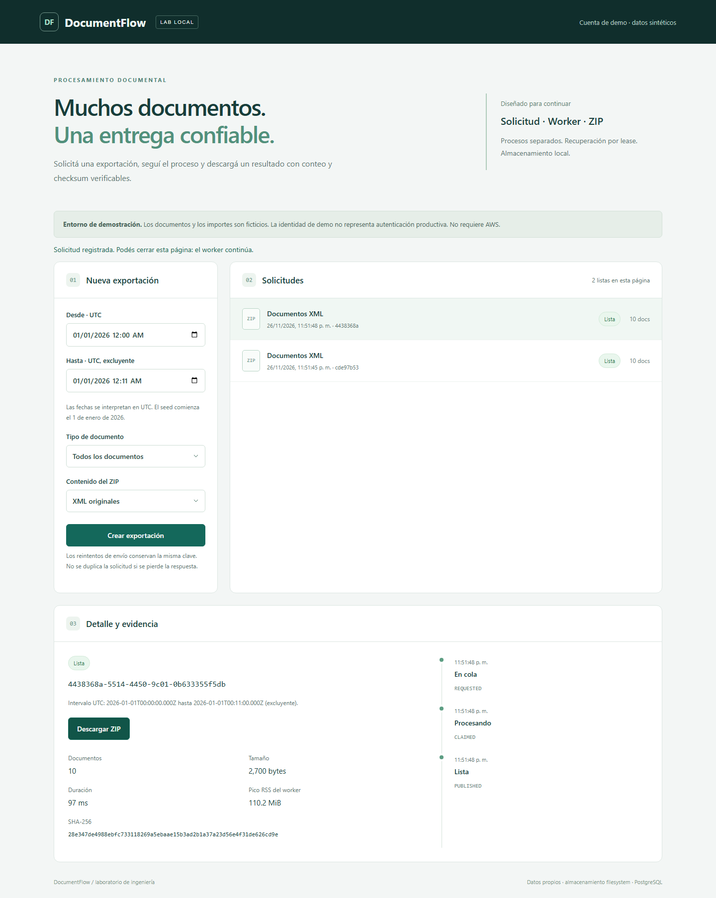

# DocumentFlow

Exportaciones documentales asíncronas con PostgreSQL, un worker independiente y entrega de ZIP por streaming. React muestra el progreso y conserva el contexto aunque se cierre la página. Todo el dataset es sintético; la demo funciona sin AWS.



[Vista móvil](docs/evidence/mobile.png) · [Video de la prueba de navegador](docs/evidence/demo.webm) · [Resultados ejecutados](docs/evidence/verification.md)

## Inicio con Docker

Requisitos: Docker Engine con Compose v2. Los puertos 4300 y 55432 deben estar libres.

```sh
docker compose up --build
```

Abrir http://localhost:4300. Compose inicia PostgreSQL 18, aplica la migración, crea 1 000 documentos y ejecuta API y worker por separado. La primera instalación descarga Chromium. Los datos sobreviven al reinicio en volúmenes Docker. `docker compose down` detiene los servicios; no elimina los datos. Las credenciales `demo/demo` pertenecen exclusivamente a esta demostración local.

## Inicio con Node y PostgreSQL

Requisitos recomendados: Node 24 LTS y PostgreSQL 17 o posterior. También se verificó Node 22.15. PostgreSQL debe permitir crear una base adicional para las pruebas.

```sh
npm ci
cp .env.example .env
docker compose up -d db
npm run db:migrate
npm run seed
npm run dev
```

En PowerShell usar `Copy-Item .env.example .env`. Si PostgreSQL ya está instalado, crear `documentflow` y configurar `DATABASE_URL` sin iniciar Docker. La API escucha http://127.0.0.1:4300 y Vite http://127.0.0.1:4301. `npm run build` compila el panel; entonces la API también lo sirve en el puerto 4300. `npm run api` y `npm run worker` permiten ejecutar cada proceso por separado.

## Recorrido

1. Elegir UTC del 1 de enero de 2026 a las 00:00 hasta las 00:11. El fin es excluyente: se exportan diez documentos del seed.
2. Crear la exportación y revisar la transición en cola, procesando y lista.
3. Descargar el ZIP. El detalle muestra conteo, tamaño, duración, RSS del worker y SHA-256. El header de descarga `X-Content-SHA256` contiene el mismo hash.
4. Elegir PDF para generar cada documento desde una plantilla local, sin entradas HTML ni acceso a red.
5. Probar cancelación mientras el job está activo. Un fallo permanente identifica el documento inválido y no publica un ZIP parcial.

Las identidades `demo` y `demo-other`, seleccionables con `X-Demo-Actor`, sirven para probar el aislamiento del contrato. No son un sistema de autenticación. Esta aplicación escucha loopback y no debe exponerse como servicio productivo sin control de acceso real.

## Contratos HTTP

`docs/openapi.yaml` documenta los endpoints. Ejemplo de solicitud:

```sh
curl -X POST http://localhost:4300/api/exports \
  -H 'Content-Type: application/json' -H 'Idempotency-Key: demo-001' \
  -d '{"from":"2026-01-01T00:00:00Z","until":"2026-01-01T00:11:00Z","kind":"all","format":"zip","render":"source"}'
```

Repetir la misma clave y payload devuelve el mismo id con 202. Cambiar el payload conservando la clave devuelve 409. Las fechas admiten un offset explícito y se normalizan a UTC. El rango se interpreta `[from,until)`. No se aceptan fechas sin zona. El navegador etiqueta sus campos como UTC y construye el instante con `Date.UTC`.

`GET /api/documents` devuelve hasta 100 documentos por cursor; `GET /api/exports` devuelve hasta 20 solicitudes por cursor. Consultar, cancelar o descargar un id ajeno devuelve 404. Descargar antes de completed devuelve 409. Los errores contienen `code`, `message` y `correlationId`, nunca un stack o cadena de conexión.

## Verificación

```sh
npm run verify
npx playwright install chromium
npm run db:migrate
npm run seed
npm run test:e2e
npm run demo:failure
npm run benchmark
```

`verify` ejecuta TypeScript estricto, build React, tests unitarios y pruebas con PostgreSQL real y Chromium. Los tests usan únicamente la base `documentflow_test` (o `TEST_DATABASE_URL`, cuyo nombre debe contener documentflow_test); crean esa base si no existe y borran sus solicitudes entre casos. Nunca apuntarlos a datos reales.

`demo:failure` mata un worker real a mitad de la exportación, espera el lease, inicia otro y exige un único artefacto. `benchmark` crea 1 000 documentos, ejecuta un worker separado y guarda entorno, dataset, duración y pico RSS en `docs/evidence/benchmark.json`. Las mediciones XML no incluyen Chromium porque no se inicia. El RSS del proceso no es un límite de memoria ni demuestra por sí solo consumo constante para cualquier volumen.

La prueba de navegador crea y descarga una solicitud desde React, comprueba ancho móvil de 390 px y errores de JavaScript, y deja capturas y video en `test-results/`. El workflow reproduce instalación, build, pruebas, demo de fallo y prueba de navegador en Linux.

## Configuración

Ver `.env.example`. `MAX_INFLIGHT_BYTES` limita un documento individual entre 64 KiB y 16 MiB; la implementación procesa secuencialmente con buffers de stream de 64 KiB. `PDF_CONCURRENCY` define un techo de 1–4; esta versión mantiene concurrencia efectiva 1. `WORKER_LEASE_SECONDS` debe ser al menos 0.5 segundos; valor recomendado 15. `DEMO_DOCUMENT_DELAY_MS` permite ralentizar el pipeline para una demostración. Los archivos se guardan bajo `STORAGE_ROOT`.

## Decisiones y límites

Arquitectura en `docs/architecture.md`, alcance en `docs/SPEC.md`, decisión de persistencia en `docs/decisions/001-local-first.md` y guion en `docs/demo.md`. Un worker vencido no puede publicar aunque retome su ejecución. Las claves finales son únicas por fencing token y solo los resultados registrados como completed se descargan. Los temporales de procesos muertos con más de una hora se limpian al arrancar un worker.

AWS está aplazado: no hay despliegue S3/ECS/Terraform ni necesidad de tarjeta o cuenta cloud. El perfil Docker de Chromium corre sin sandbox dentro de un contenedor sin privilegios; acepta exclusivamente una plantilla fija con texto escapado, JavaScript deshabilitado y peticiones de red bloqueadas. El perfil Node local conserva el sandbox. La demo no emite documentos fiscales, no contiene datos de la empresa y no es un sistema multiempresa.

No se incluye una licencia de redistribución elegida en nombre del autor. La decisión de licencia queda pendiente de su elección; los permisos de uso no se deben inferir por ser un repositorio público.
